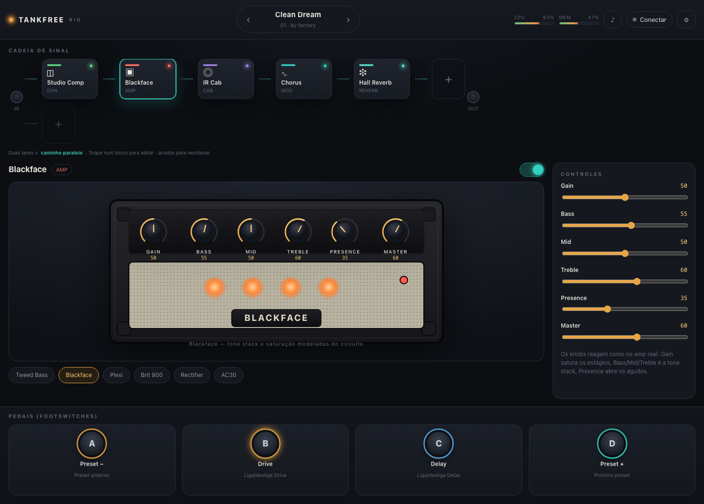
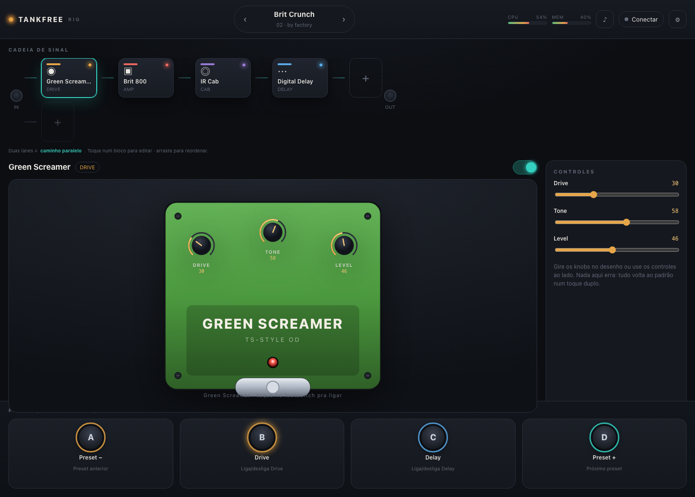
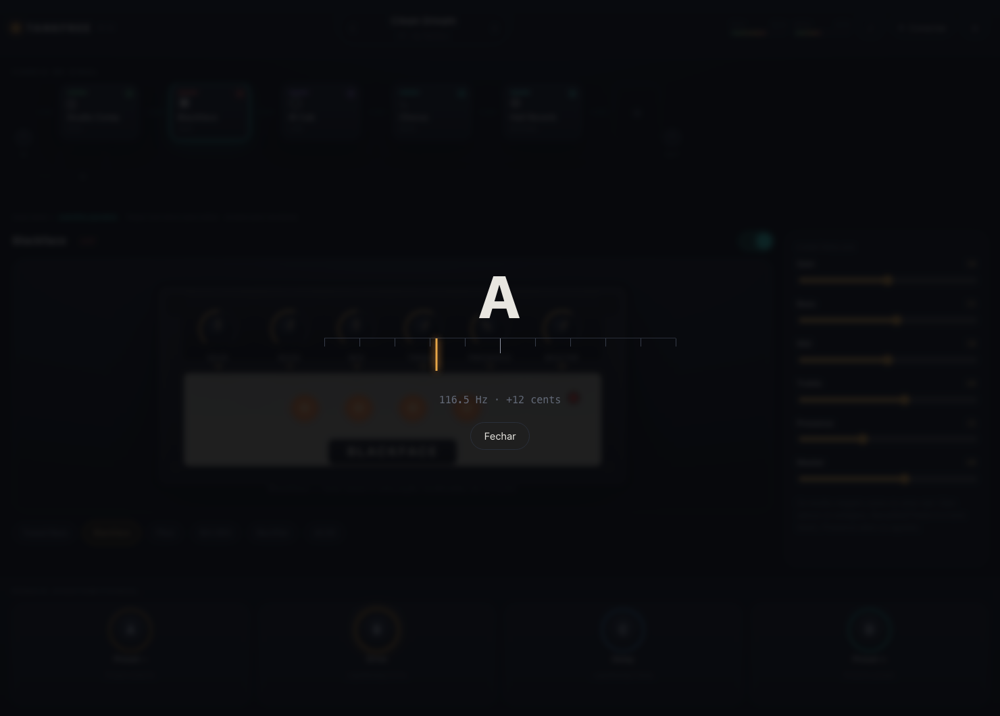
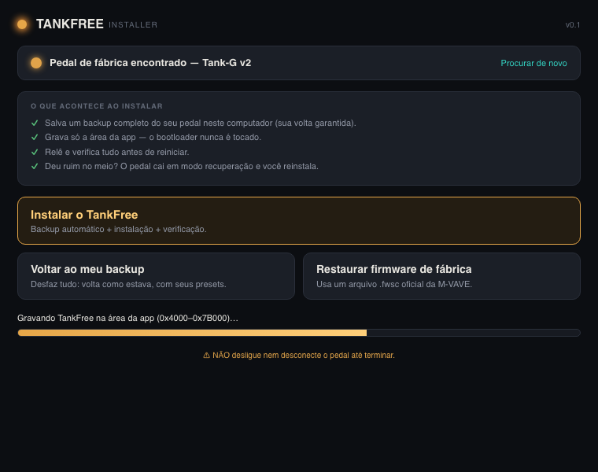

<div align="center">

# TankFree

**An open, community firmware & toolkit for the M-VAVE Tank-G / Tank-B v2 guitar pedal**
*(SoC: JieLi AC791N · CPU pi32v2)*

[](../../actions)
[](LICENSE)


</div>

> ⚠️ **Independent project — not affiliated with M-VAVE, MOOER, JieLi or Valeton.**
> Installing custom firmware can brick your pedal and voids its warranty. Use at
> your own risk, on hardware you own. Read [`DISCLAIMER.md`](DISCLAIMER.md).

TankFree aims to replicate (and extend) the original Tank-G tones with a
clean-room open firmware, plus the tooling you need to live with it: a flasher
and a browser-based editor.

## The editor

<p align="center"></p>

A browser editor (Chrome/Edge — Web Serial + Web MIDI + BLE). A Quad Cortex-style
**signal grid** with parallel lanes on top; ToneX-style **per-block realism** below
— every amp and pedal is drawn like the real thing, with knobs that behave like the
circuit. Drag blocks to reorder, dial in a tone, map the footswitches.

| Every block drawn for real | Built-in tuner |
|:--:|:--:|
|  |  |

> Try it now — no pedal needed: `cd manager && python3 -m http.server 8000`, open
> <http://localhost:8000> in Chrome/Edge. It runs in demo mode until a pedal is connected.

## One-click install

<p align="center"></p>

Download the installer for your system from [Releases](../../releases), **double-click,
done** — nothing to install. It **backs up your pedal first**, writes TankFree, and
verifies. Buttons to **go back to your backup** or **restore M-VAVE factory firmware**
are right there. macOS and Windows; both binaries are built automatically by CI.

## What's inside

| Folder | What it is | Status |
|---|---|---|
| [`installer/`](installer/) | One-click GUI installer (macOS/Windows, zero deps) + offline firmware tools. Validated JieLi crypto. | GUI ✅ · crypto ✅ · flashing 🚧 |
| [`manager/`](manager/) | Web editor — Web Serial + Web MIDI (Valeton **GP-5**-style map) + BLE. QC-style grid, ToneX-style block art, presets, captures, IRs. | editor ✅ · live data 🚧 |
| [`firmware/`](firmware/) | The on-pedal app (pi32v2, JieLi AC79 SDK). | skeleton 🧪 |
| [`docs/`](docs/) | Reverse-engineering notes, firmware spec, GP-5 MIDI map. | ✅ |

## Status & roadmap

Full checklist in **[`ROADMAP.md`](ROADMAP.md)** (renders as a live task list). In short:

- ✅ **Reverse engineering** — hardware, crypto, protocol, formats, factory tones; all confirmed on a live pedal.
- ✅ **Tooling** — `jltech` crypto, `fwtool`, `tankctl` (edit a live pedal from the terminal), one-click installer GUI.
- ✅ **Editor** — QC-grid + ToneX-realism, demo mode, reads a real pedal (presets/captures/IRs/meters); also a native **desktop app** (`app/`, Electron).
- 🚧 **Live editing in the UI**, **Electron packaging**, **flasher backend**.
- ⬜ **Our firmware** (the big track): SDK/toolchain → booting fw → audio → engine → flash & configure end-to-end.

Can I use it today? Configure a pedal over serial ✅ · flash *our* firmware ⬜ (Phase 3).

## Features (target)

- **Audio** 48 kHz / 24-bit (user-selectable 96 kHz), no internal resample.
- **Amps** NAM A2-Lite capture engine + factory-style captures + algorithmic amps.
- **Cabs** impulse-response convolution; load your own `.wav`.
- **Free effects chain** — arbitrary routing and parallel branches, no fixed slots.
- **Presets** 32 × 4 scenes.
- **MIDI** identical to the Valeton GP-5 over USB-MIDI and BLE-MIDI
  (see [`docs/MIDI_GP5.md`](docs/MIDI_GP5.md)).
- **Editor** in Chrome/Edge over USB — no app install.

## Quick start (works today, no pedal needed)

```bash
# validate the crypto and run the unit tests
python3 installer/tests/test_cipher.py

# serve the web editor locally (Chrome/Edge)
cd manager && python3 -m http.server 8000   # then open http://localhost:8000
```

The flasher and the firmware build need the physical pedal and the pi32v2
toolchain — see [`installer/README.md`](installer/README.md) and
[`firmware/README.md`](firmware/README.md).

## Bring your own files

This repo ships **no proprietary content**. To use the tools you supply your own
firmware, captures and IRs from your device / official sources. Flash dumps and
backups hold your pedal's unique Bluetooth identity — **never share them**.

## Contributing

PRs welcome — please keep it **clean-room** (don't paste decompiled proprietary
code). See [`CONTRIBUTING.md`](CONTRIBUTING.md) and [`DISCLAIMER.md`](DISCLAIMER.md).

## Credits & prior art

Stands on the shoulders of the JieLi RE community: kagaimiq (jl-uboot-tool,
jl-misctools, ghidra-jieli), jvitkauskas (pi32v2-isa / pi32v2-llvm), the FM-1 and
SMK-37 RE projects, the JieLi AC79 SDK, and the open **Neural Amp Modeler**.

## License

[GPL-3.0](LICENSE). *(Default choice — open to discussion before 1.0.)*
